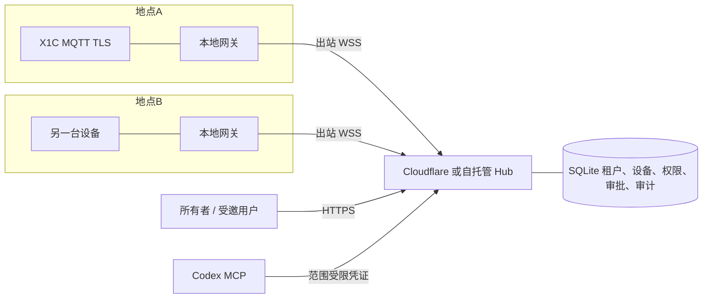
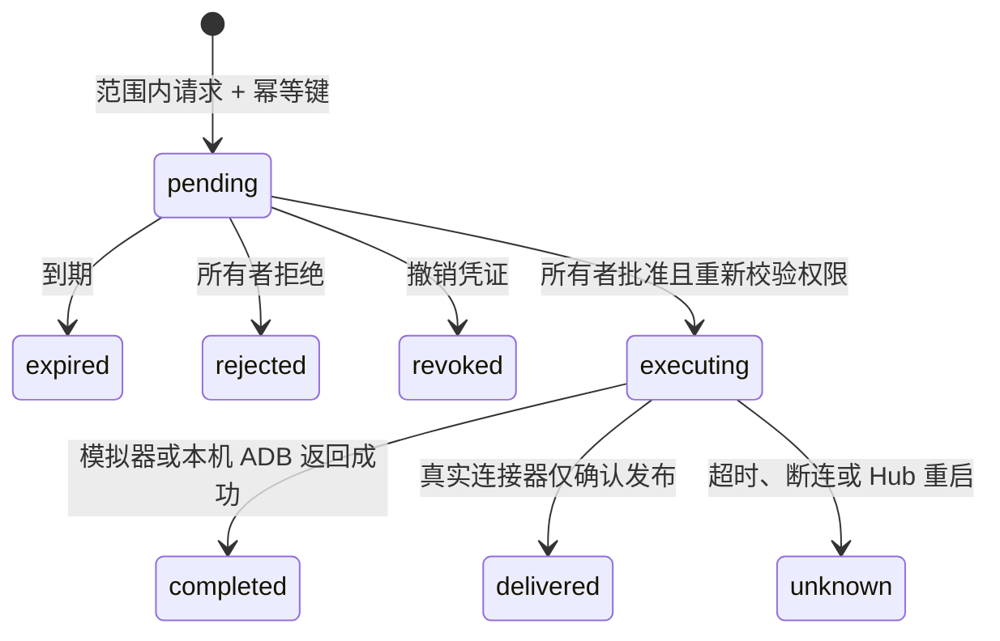

# MeshMind v3 · 设备能力 SaaS

## 产品目标与当前落地

任何所有者都能建立自己的设备空间，在各个网络放置网关，让指定用户或 Agent 通过公网调用明确授权的设备能力。第一个可验证场景：X1 Carbon → 地点网关 → Hub → Codex MCP。

用户确认的条件：Tailscale 不作为大陆网络主链路；设备分布于不同网络；需要授权其他用户与 Agent；先交付本地与容器版本；展示硬件为 X1C。

v3 替代原先“Cloudflare 控制平面确定版”的默认方向。当前已将 SaaS 部署到 Cloudflare Workers 与持久化 Durable Objects SQLite，自托管 Hub 和容器仍可运行。不能把部署模板或某个服务品牌当成可达性保证。

## 连接模型

所有用户连接 Hub。网关只建立出站连接，无需给局域网设备开放公网端口。当前网关按预配置的设备与能力执行请求，云端不能传入任意 LAN 地址、MQTT topic、原始报文或 Shell 命令。

同一网关的 `localId` 只在网关内部唯一。Hub 为每个设备生成全局 ID，并绑定不可由请求修改的租户和网关。因此不同地点都使用 `192.168.1.x`、或设备都叫 `x1c` 不会造成身份冲突。

这提供的是跨网络**能力调用**。此前讨论的通用网络互通仍是后续独立数据平面：采用成熟反向隧道或路由组件，另外授予目标服务／端口权限。当前不承诺任意 TCP/UDP 访问、虚拟 IP、组播发现或远程桌面。

## 身份与租户隔离

当前一个账号对应一个独立设备空间，账号是所有者。受邀用户／Agent 使用所有者签发的独立 bearer，不获得账号密码或所有者会话。

- 所有 HTTP 请求从会话或 bearer 解析租户。请求体中没有可选的 `tenantId`。
- 查询设备、网关、凭证、审批、审计均带租户条件。
- bearer 绑定设备 ID 列表、操作列表、到期时间；没有全设备通配符。
- 共享用户不是当前空间的管理员，不能添加网关、签发凭证、读取审计或批准动作。
- bearer 错误时不回退到浏览器所有者 Cookie。
- 账号使用 scrypt，Cookie 使用 HttpOnly、SameSite=Strict、HTTPS 时 Secure；所有 Cookie 写操作校验 Origin。

已增加 Google OIDC 授权码登录。Google 身份以稳定的 `sub` 关联账号，独立的 `account_identities` 表保证同一 Google 身份不能跨设备空间关联。新用户遵循开放注册开关；已有密码账号通过已登录所有者主动关联，邮箱相同不自动合并。仅申请 `openid email`，不持久化 Google access／refresh token。

登录使用服务端授权码、PKCE S256、nonce 和一次性 state。OAuth 临时浏览器 Cookie 使用 Lax，以接收跨站顶层回调；主会话仍使用 Strict。临时 verifier 保存在私有 SQLite 中，流程完成时删除，到期流程在后续登录开始时清理。关联回调重新确认发起者的所有者会话仍有效，退出登录会阻止尚未完成的关联。

生产身份体系仍需本地邮箱验证、找回、站点自身的 MFA 与组织成员邀请；不将 Google 登录接入描述为完整的商业身份平台。

## Agent 的直接 MCP 入口

Hub 的 `/mcp` 提供官方 SDK Streamable HTTP，采用无状态 JSON POST；原 stdio 桥接保留，两种传输共用工具定义。直接入口不通过公网地址回调自己的 API，而是复用 Hub 内部同一套设备枚举、状态、动作申请和审批查询函数，避免内外网部署差异及权限逻辑分叉。

每个 HTTP 请求必须携带有效的独立 bearer，浏览器所有者 Cookie 或 URL 参数均不能登录 MCP。每个工具调用再次验证到期与撤销，不依赖可转移的 MCP 会话 ID。Host 必须与 PUBLIC_URL 一致，Origin 如果存在也必须匹配。请求体上限 64 KiB，并发上限 16；禁用批量消息，限制来源 IP 和主体请求速率。响应完成或断连时关闭协议对象，无持续 SSE 和服务端推送。

工具只允许列举已授权设备、读取状态或 Android 界面结构、申请控制及查询自身审批。Agent 无批准、签发权限或获取网关密钥的工具。公网部署仍依赖正确配置的 HTTPS 和真实网络可达性，本机入口不能让其他网络的 Agent 自动访问。

ADB 连接器将设备序列号固定在网关本地配置，并强制使用本机 ADB 服务；Hub 不接收设备序列号或任意 shell 命令。`adb_status` 只读设备信息。`adb_ui` 需本地开启 `allowUiDump`，且单独授权，返回的界面 XML 可能包含个人信息。`request_adb_input` 只接受有界的点击、滑动、常用按键和安全字符输入；本地 `allowControl`、主体范围和所有者逐次审批三关均须通过。审批参数保存在 Hub 中供所有者核对，不应输入密码。当前没有截图、APK 安装、文件传输或通用 ADB shell 工具。

## 网关入网与会话

1. 所有者创建网关，Hub 签发 10 分钟、一次性的入网令牌。
2. 网关本地生成 Ed25519 密钥对，通过 HTTPS 兑换 bearer；Hub 仅存公钥与 bearer 摘要。
3. 网关用 bearer 建立 WSS。Hub 下发随机挑战，网关签名 `challenge + 换行 + gatewayId + 换行 + manifestJson`。
4. Hub 验签后才允许设备上线、心跳和任务结果。
5. 每个任务绑定原始已验证的 WebSocket 会话。别的连接不能凭任务 ID 回传结果。
6. 同一网关重连时替换旧连接；撤销网关断开其连接并禁用相关设备访问。

入网兑换是 SQLite 同步事务。连接数、报文大小、设备数量、并发任务数和等待时间有上限。协议不支持离线物理动作队列。

## X1C 与本地权限

拓竹地址、序列号、LAN 访问码、固定证书只出现在网关本地配置。Hub 清单包含设备显示名、型号、连接器类型、能力和匿名本地 ID。状态响应只包含白名单字段，不传出完整 MQTT 报文。

默认只读。控制需要本地 `allowControl=true`，然后由所有者给指定主体授予对应操作，再逐次批准。第一版只有 `status/pause/resume/stop`，不支持文件上传、启动打印、原始命令、Shell 或通用代理。

真实固件兼容性、证书链与 LAN 模式需真机验证。TLS 不允许 `rejectUnauthorized=false`。首次固定证书依赖可信局域网的人工核对；不宣称自动证明了打印机身份。

## 控制状态机

审批不授予新权限。批准前重新检查请求者有效期与撤销状态、设备归属、当前能力与网关在线状态。相同主体的相同幂等键不会产生第二次执行；重复批准返回冲突。

真实 MQTT 发布不等于设备执行。网络中断时可能已经执行，也可能没有执行，必须标记未知且不自动重试。已经发出的实体设备动作无法通过撤销凭证回滚。

## 信任与部署边界

Hub 是可信授权方，能够看到筛选后的状态并路由动作。TLS 是分段传输加密，不是针对 Hub 的端到端加密。本地能力上限可以限制 Hub，但已启用控制的网关仍需信任 Hub 的审批决定。

网关主机、打印机所在局域网、本地配置文件和浏览器所有者会话都属于安全边界。当前授权是能力级的，不授权整个局域网。日志不包含凭证，但 SQLite 和网关身份仍需安全备份。

当前公网部署：Workers Static Assets / API → SaasHub Durable Object → 持久化 SQLite。网关使用 WebSocketPair，复用原有连接验证；Node HTTP 适配复用原有权限和 MCP 路由。它保持单 Hub MVP 的协调方式，尚未实现空间分片与 WebSocket 休眠。自托管模板仍为 Caddy HTTPS/WSS → 单实例 Hub → SQLite 持久卷。Google OAuth 客户端凭证通过私有配置注入，重定向地址从 `PUBLIC_URL` 生成，不信任请求 Host。当前未实现高可用多副本、分布式任务路由、计费和配额、邮件验证与账户找回、灾备自动化。正式公开运营前需要补齐并进行独立安全评估。

## 演进顺序

1. 用 X1C 真机验证 LAN 模式、证书、状态推送和审批控制。
2. 完成 Google 应用正式发布与品牌配置，补齐站点 MFA、成员邀请、反滥用、配额、备份与告警。
3. 按相同连接器协议接入 Home Assistant、电脑受限任务、本地模型等能力。
4. 增加独立成熟的 TCP/UDP 传输组件，按服务／端口授权，验证各地点实际网络。
5. 随规模迁移数据库、共享消息路由与网关调度，保留租户和会话绑定约束。
